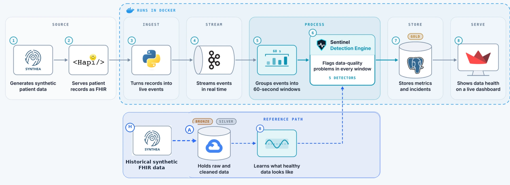

# Sentinel Architecture

## Overview

Sentinel has two complementary paths. The **live streaming path** carries synthetic FHIR records from a data generator to a dashboard. The **historical reference path** turns a larger set of healthy synthetic data into a baseline: a picture of what normal looks like. The two meet in the **detection engine**, which compares every live window with that baseline.

Sentinel monitors data health, not patient health. The dashboard is for data-engineering and data-quality teams, not a clinical tool.

## Live streaming path

`Synthea → HAPI FHIR → Python producer → Kafka → 60-second windows → detection engine → PostgreSQL → Streamlit`

| Step | What happens | In this repository |
| --- | --- | --- |
| Synthea | Generates fresh synthetic patients as FHIR files | Run through a local JAR by `src/sentinel/streaming/replay.py` |
| HAPI FHIR | Shown in the diagram as the layer that serves records as FHIR | **Not used by the code** (see below) |
| Python producer | Reads Patient, Encounter and Observation resources and publishes them as events | `src/sentinel/streaming/producer.py` |
| Kafka | Carries the events in real time (topic `fhir-observations` by default) | `docker-compose.yml` |
| 60-second windows | Groups events into fixed windows | `src/sentinel/streaming/windows.py` |
| Detection engine | Runs the five checks on each window | `src/sentinel/detection/`, `scripts/run_monitor.py` |
| PostgreSQL | Stores metrics and incidents | `sql/schema.sql`, `src/sentinel/storage/postgres.py` |
| Streamlit | Shows data health to the team | `src/sentinel/dashboard/app.py` |

### HAPI FHIR: diagram vs code

The architecture diagram includes a HAPI FHIR step. The code in this repository does not contact a HAPI FHIR server: `replay.py` runs Synthea with its bulk-FHIR export and the producer reads the resulting NDJSON files directly. You do **not** need to run HAPI FHIR to use Sentinel here. The diagram's "Runs in Docker" boundary is likewise conceptual: `docker-compose.yml` only runs Kafka and PostgreSQL, while the monitor, replay and dashboard run from your Python environment.

## Historical reference path

`Synthea → historical synthetic FHIR data → GCS Bronze → normalization → GCS Silver → baseline profiling → detection engine`

Synthea generates the data. Google Cloud Storage only stores it.

- **Bronze** holds the raw historical FHIR files (NDJSON).
- **Silver** holds the normalized version as Parquet (observations and encounters are used for baselines).
- **Baseline profiling** (`python -m sentinel.baseline.builder`) reads Silver and writes `config/baselines.json`.

`config/baselines.json` is committed, so running the monitor locally does not need Google Cloud access. Rebuilding it, or running the `sentinel.transformation.build_silver*` modules, does.

## Monitoring windows

The monitor uses **60-second tumbling windows** (`WINDOW_SECONDS = 60` in `scripts/run_monitor.py`). A record is placed in a window using the time its message was sent to Kafka (its arrival time), not the clinical timestamp inside the FHIR record. A window is closed and checked when the first record of a later window arrives.

## Detection engine

Each check asks a plain question first; the method follows.

| Check | Question | Method in the code |
| --- | --- | --- |
| Contract Validation | Does the record still follow the expected rules? | Rule-based validation for Observation, Patient and Encounter (`detection/contract.py`, `patient_contract.py`, `encounter_contract.py`; rules in `config/monitoring.yaml`) |
| Missingness | Did information that is normally present disappear? | Compares a window's null rate for `numeric_value` with the median and median absolute deviation (MAD) of recent healthy windows, plus a minimum increase |
| Volume | Are we receiving the amount of data we expect? | Compares the record count with the median and MAD of recent healthy windows, plus a minimum percentage change |
| Numeric Drift | Did numeric values start behaving differently? | Two-sample Kolmogorov–Smirnov test on per-patient medians, with a minimum effect size (heart rate, systolic blood pressure, glucose) |
| Categorical Drift | Did the mix of categories unexpectedly change? | Jensen–Shannon distance against baseline proportions (smoking status for Observations, class code for Encounters) |

Thresholds live in `config/monitoring.yaml` and in the constants at the top of each detector.

## PostgreSQL

Defined in `sql/schema.sql`:

| Table | Holds |
| --- | --- |
| `resources` | The FHIR resource types being monitored |
| `quality_metrics` | One row per window, metric and field |
| `baseline_metrics` | Stored baseline values |
| `schema_history` | Observed field additions, removals and type changes |
| `incidents` | Detected problems, with severity (`low`, `medium`, `high`, `critical`) and status (`open`, `acknowledged`, `resolved`) |

The tables are not created automatically; apply the schema once as described in the root README.

## Streamlit dashboard

Three pages: **Overview**, **Data Quality** and **Incidents**. It reads from PostgreSQL and shows evidence (the metric, the baseline and the message) rather than only a red or green status.

## Design decisions

- **Fixed historical baseline.** The monitor compares against a baseline built once from healthy historical data, rather than learning "normal" from the first minutes of the stream. This keeps the controlled prototype predictable.
- **Arrival-time windows.** Fixed 60-second windows on arrival time keep volume monitoring simple and independent of how old a record's clinical timestamp is.
- **Explainable incidents.** Each incident stores what was observed, what was expected and a readable message, so an engineer can see why it opened.
